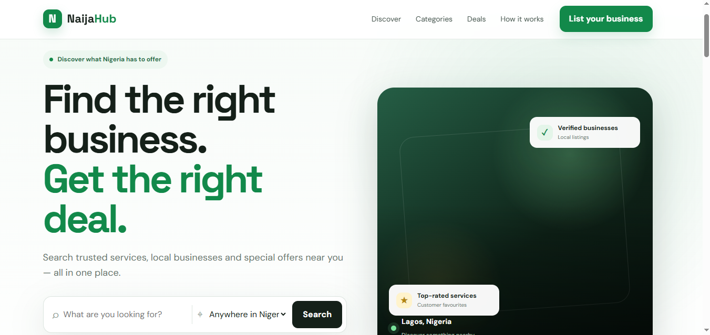

# NaijaHub — Local Business Discovery Platform

NaijaHub is a web application designed to help people discover local businesses, explore services, find deals, and read customer reviews across Nigeria.

## Project Preview

## Features

- Business listings and categories
- Individual business profiles
- Business submission and admin approval
- Customer reviews and ratings
- Featured business listings
- Paystack Test Mode payment integration in development

## Technologies

- PHP
- MySQL
- HTML
- CSS
- JavaScript
- XAMPP

## Project Status

NaijaHub is an ongoing portfolio project. Features are being tested and improved.

## Developer

Built as a web development portfolio project.